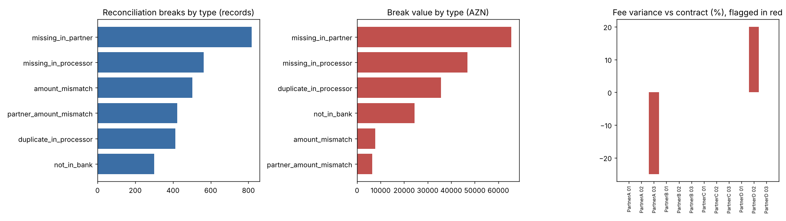
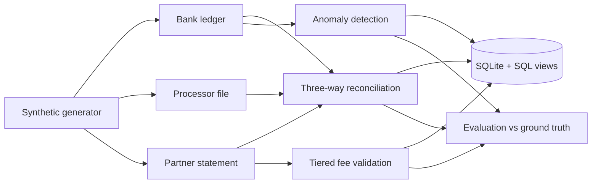

# payment-recon-engine

[](https://github.com/RagifHajiyev/payment-recon-engine/actions/workflows/ci.yml) 

Three-party payment reconciliation, tiered-fee validation and anomaly detection, built and tested on **fully synthetic data**.

It reproduces a common operations-control problem: the bank ledger, the processor file and the partner statement should agree, but records go missing, get duplicated, or carry different amounts, and partners sometimes bill the wrong fee tier. The project finds those breaks automatically, values them in AZN, and reports them through SQL views.

> All data, partner names, FX rates and fee tiers are fictional and for illustration only. No real company data is used.



## What it does

| Step | Module | Description |
| --- | --- | --- |
| 1 | `generate_data.py` | Seeded generator for 100k transactions in AZN/USD/EUR with **planted, labelled errors** (so accuracy can be measured exactly) |
| 2 | `reconcile.py` | Three-way match on a reference key; labels each record and values breaks in AZN |
| 3 | `fees.py` | Independently recomputes volume-tiered monthly partner fees and flags billing differences |
| 4 | `anomaly.py` | Flags abnormal amounts with a robust z-score rule and an Isolation Forest |
| 5 | `db.py` + `sql/views.sql` | Loads results into SQLite and exposes reporting views |
| 6 | `evaluate.py` | Scores every detector against the planted ground truth |



## Quick start

```bash
git clone https://github.com/RagifHajiyev/payment-recon-engine.git
cd payment-recon-engine
python -m venv .venv && source .venv/bin/activate   # Windows: .venv\Scripts\activate
pip install -r requirements.txt
PYTHONPATH=src python -m recon_engine.pipeline --n 100000   # ~6 seconds
pytest -q
```

Windows PowerShell: `$env:PYTHONPATH="src"; python -m recon_engine.pipeline --n 100000`

Outputs land in `output/`: `reconciliation_results.csv`, `break_summary.csv`, `fee_validation.csv`, `anomalies.csv`, `metrics.json`, `recon.db`, `summary.png`.

## Try it without running anything

The full 100k-row dataset is not stored in the repo. It is generated on demand from a fixed seed, so anyone gets identical data. A small sample (2,000 transactions, seed 42) is included in [`sample_data/`](sample_data/):

| File | What it is |
| --- | --- |
| `bank_ledger.csv` | Master record: ref, timestamp, partner, currency, amount |
| `processor_file.csv` | Processor's view of the same transactions |
| `partner_statement.csv` | Partner's view, including the fee it charged |
| `ground_truth.csv` | Answer key: which records have a planted error and what kind |
| `fee_truth.csv` | Answer key: which partner-months were billed the wrong rate |

To test the engine yourself: run the quick start, open `output/break_summary.csv`, then check any `ref` from `output/reconciliation_results.csv` against `sample_data/ground_truth.csv`. The engine never reads the answer key; it is only used by `evaluate.py` to score the results.

## Results (100,000 transactions, seed 42)

**Reconciliation.** 97,282 records matched; 3,018 breaks worth AZN 186,672.86.

| Issue | Records | Value (AZN) | Precision | Recall |
| --- | ---: | ---: | ---: | ---: |
| missing_in_partner | 818 | 65,543.37 | 1.00 | 1.00 |
| missing_in_processor | 563 | 46,868.88 | 1.00 | 1.00 |
| amount_mismatch | 503 | 7,715.94 | 1.00 | 1.00 |
| partner_amount_mismatch | 422 | 6,473.96 | 1.00 | 1.00 |
| duplicate_in_processor | 412 | 35,655.44 | 1.00 | 1.00 |
| not_in_bank | 300 | 24,415.27 | 1.00 | 1.00 |

**Fee validation.** Both planted billing errors found (PartnerA Mar 2026 under-billed by 25%, PartnerD Feb 2026 over-billed by 20%) with no false alarms.

**Anomaly detection** (189 planted amount outliers):

| Detector | Flagged | Precision | Recall |
| --- | ---: | ---: | ---: |
| Robust z-score | 198 | 0.88 | 0.92 |
| Isolation Forest | 199 | 0.88 | 0.93 |
| Either | 209 | 0.84 | 0.93 |

## Reading these results honestly

- The reconciliation scores are perfect because the planted errors are clean and the matching rules are deterministic. Real data is messier (timing differences, partial settlements, reference formatting), so treat 1.00 as "the logic is correct", not "real-world accuracy".
- The anomaly numbers are the meaningful ones. The Isolation Forest first scored about 2% precision because uninformative features (hour of day, partner dummies) diluted it. Restricting it to amount-based features fixed this. See the `isolation_forest_flags` docstring.
- `contamination=0.002` equals the planted outlier rate, which a real analyst would not know. At 0.003 the forest keeps recall near 0.97 but precision drops to about 0.62. Tuning this is a business trade-off between missed anomalies and review workload.

## SQL views

`sql/views.sql` defines `v_daily_breaks`, `v_partner_breaks`, `v_unmatched_value`, `v_fee_flags` and `v_variance_by_partner_month`.

```sql
SELECT * FROM v_unmatched_value;   -- break count, AZN value and share by issue type
SELECT * FROM v_fee_flags;         -- partner-months billed outside contract
```

## Project structure

```
src/recon_engine/   generate_data, reconcile, fees, anomaly, evaluate, db, pipeline
sql/views.sql       reporting views
tests/              21 pytest tests (matching logic, tiers, fee checks, detectors, SQL)
.github/workflows/  CI on Python 3.10 and 3.12
docs/summary.png    output chart
```

## Possible extensions

- Streamlit or Power BI dashboard on top of `recon.db`
- Fuzzy matching for reference mismatches and timing windows
- Partial-settlement and FX-rate-by-date handling
- Alerting thresholds and an exceptions workflow

## License

MIT
